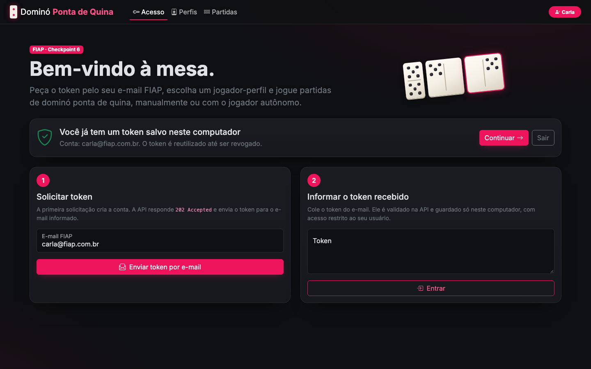
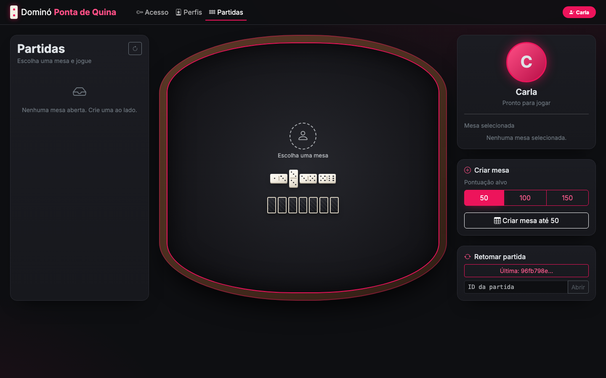
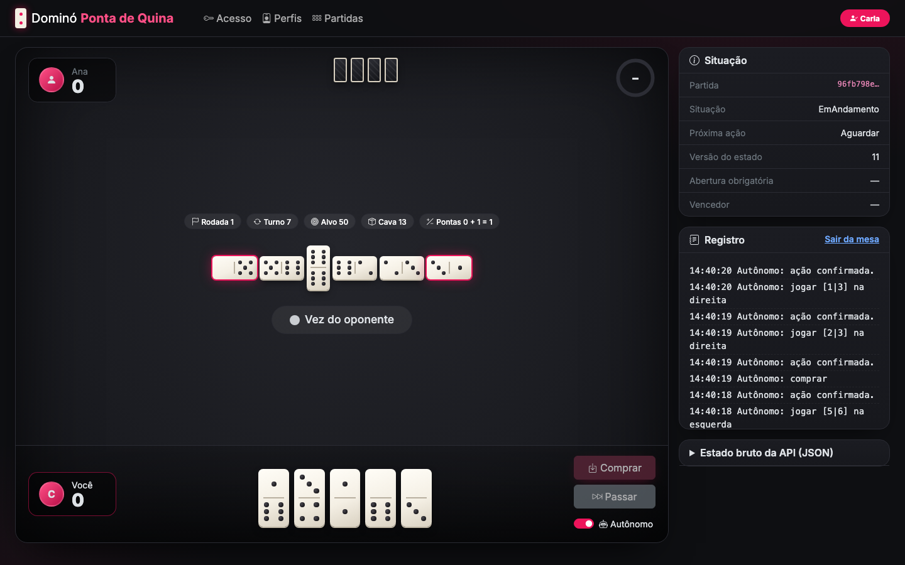
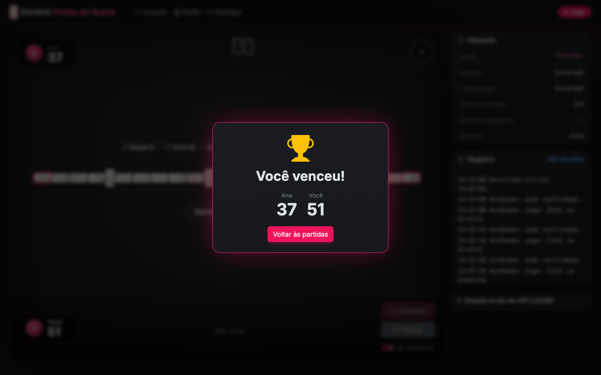

# Dominó Ponta de Quina · Cliente C#

Cliente em **C# / .NET 10** para o **Checkpoint 6 (FIAP)**: uma pessoa entra, escolhe um jogador-perfil
e joga uma partida completa de dominó ponta de quina contra outro jogador pela API oficial. Também dá para
deixar o **jogador autônomo** jogar sozinho, tanto pela interface quanto por linha de comando.

| Acesso | Sala de partidas |
|---|---|
|  |  |

| Mesa durante o turno | Resultado |
|---|---|
|  |  |

---

## Sumário

1. [O que o projeto entrega](#o-que-o-projeto-entrega)
2. [Arquitetura](#arquitetura)
3. [Pré-requisitos](#pré-requisitos)
4. [Como executar](#como-executar)
5. [Como jogar (passo a passo)](#como-jogar-passo-a-passo)
6. [Regras implementadas](#regras-implementadas)
7. [Jogador autônomo](#jogador-autônomo)
8. [Comunicação com a API](#comunicação-com-a-api)
9. [Segurança das credenciais](#segurança-das-credenciais)
10. [Testes automatizados](#testes-automatizados)
11. [Simulador local da API](#simulador-local-da-api)
12. [Contrato da API e o que conferir no Swagger](#contrato-da-api-e-o-que-conferir-no-swagger)
13. [Estrutura de pastas](#estrutura-de-pastas)
14. [Integrantes](#integrantes)

---

## O que o projeto entrega

| Requisito do checkpoint | Onde está |
|---|---|
| Solicitar acesso (token por e-mail) e autenticar com Bearer | Tela **Acesso**, `ServicoConta.SolicitarTokenAsync` / `DefinirTokenAsync` |
| Criar e escolher jogador-perfil, ativar neste cliente com chave própria | Tela **Perfis**, `ServicoConta.AtivarAsync`, `GeradorChaveAtivacao` |
| Retomar a ativação e liberar o perfil para outro cliente | `ServicoConta.GarantirAtivacaoAsync` / `DesativarAsync` |
| Criar mesa, listar mesas com vaga e ingressar | Tela **Partidas** |
| Iniciar a partida com dois participantes | Botão **Iniciar partida** na mesa |
| Mostrar mão própria, mesa, pontas, pedras do adversário (só a quantidade), rodada, turno, placar, situação, versão e vencedor | Tela **Jogo** (`/jogo/{id}`) |
| Enviar jogar / comprar / passar com perfil, versão e chave de idempotência | `SessaoPartida` + `DominoApiClient` |
| Acompanhar o estado com `/atualizacoes` (200 / 204) | Laço da tela de jogo e `SessaoPartida.AtualizarAsync` |
| Explicar rejeições sem fingir que deram certo (401, 403, 409, 422, 429) | `ApiException.MensagemParaUsuario` e alertas na tela |
| Interface com cara de jogo: mesa, pedras, placar, turno e relógio | Bootstrap 5 + tema próprio (feltro, pedras com pips, relógio do turno) |
| Jogador autônomo | Interruptor **Autônomo** na mesa e o bot `DominoQuina.Bot` |
| Testes automatizados | `tests/DominoQuina.Tests`: 110 testes (unitários e de integração) |
| Diagrama de classes | [`docs/diagrama-classes.md`](docs/diagrama-classes.md) |

---

## Arquitetura

```
DominoQuina.slnx
├── src/DominoQuina.Core        Biblioteca: domínio, regras, cliente HTTP, sessão, jogador autônomo
├── src/DominoQuina.Web         Interface Blazor Server (Bootstrap 5, tema escuro FIAP)
├── src/DominoQuina.Bot         Jogador autônomo de linha de comando
├── tools/DominoQuina.Simulador Simulador local da API (em memória), para desenvolvimento e testes
└── tests/DominoQuina.Tests     xUnit: testes unitários e de integração
```

A **API é a autoridade**: ela distribui as pedras, escolhe quem abre, valida as jogadas e calcula a pontuação.
O cliente:

- mostra só o que o participante pode ver;
- usa as regras localmente apenas para **não enviar movimentos proibidos** (que, pela regra futura,
  descontam 1 ponto) e para destacar as pedras jogáveis;
- aplica na tela **apenas estados confirmados** pela API, e só se a versão for mais nova.

Camadas do `DominoQuina.Core`:

| Pasta | Responsabilidade |
|---|---|
| `Dominio/` | `Pedra`, `Lado`, `ProximaAcao`, `EstadoJogo`, `RegrasDomino`, `OrientadorMesa` |
| `Api/` | `DominoApiClient` (uma rota por método), `RotasApi`, `Contratos` (DTOs), `MapeadorEstado`, `ApiException` |
| `Conta/` | `ServicoConta`: token, perfis, ativação e liberação |
| `Armazenamento/` | `ArmazenamentoCredenciais`: token e chaves de ativação em disco, com permissão restrita |
| `Seguranca/` | `GeradorChaveAtivacao`: 32 bytes aleatórios em 64 caracteres hexadecimais |
| `Jogo/` | `SessaoPartida` (estado confirmado, comandos, versão, idempotência, novas tentativas), `Decisao`, `ResultadoAcao` |
| `Autonomo/` | `IEstrategia`, `EstrategiaGulosa`, `JogadorAutonomo` |

O diagrama de classes completo e o diagrama de sequência de um turno estão em
**[`docs/diagrama-classes.md`](docs/diagrama-classes.md)**.

---

## Pré-requisitos

- [.NET SDK 10](https://dotnet.microsoft.com/download) (`dotnet --version` deve mostrar 10.x)
- Um e-mail FIAP para receber o token
- Navegador moderno (a interface carrega Bootstrap e ícones por CDN)

```bash
git clone https://github.com/felipe3103/cp6-CSharp.git
cd cp6-CSharp
dotnet build
```

---

## Como executar

### Interface web contra a API oficial

```bash
dotnet run --project src/DominoQuina.Web
```

Abra **http://localhost:5070**. A URL da API fica em `src/DominoQuina.Web/appsettings.json`
(`DominoApi:UrlBase`) e também pode vir da variável de ambiente `DominoApi__UrlBase`.

### Interface web contra o simulador local

Em dois terminais:

```bash
dotnet run --project tools/DominoQuina.Simulador          # API simulada em http://localhost:5150
dotnet run --project src/DominoQuina.Web --launch-profile simulador
```

No simulador o token não vai por e-mail: ele aparece no log do simulador e também em
`http://localhost:5150/dev/token?email=seu@fiap.com.br`.

### Jogador autônomo (console)

```bash
# 1. Token
dotnet run --project src/DominoQuina.Bot -- token --email aluno@fiap.com.br
dotnet run --project src/DominoQuina.Bot -- token --definir <TOKEN-DO-EMAIL>

# 2. Perfil
dotnet run --project src/DominoQuina.Bot -- perfis --criar "Bot do Grupo"
dotnet run --project src/DominoQuina.Bot -- ativar "Bot do Grupo"

# 3. Jogar (escolha um)
dotnet run --project src/DominoQuina.Bot -- jogar --alvo 50              # cria mesa, espera, inicia e joga
dotnet run --project src/DominoQuina.Bot -- jogar --entrar <partidaId>   # entra numa mesa de outro grupo
dotnet run --project src/DominoQuina.Bot -- jogar --entrar-qualquer      # entra na primeira mesa com vaga
dotnet run --project src/DominoQuina.Bot -- jogar --partida <partidaId>  # retoma uma partida
```

Opções gerais: `--cliente <nome>` usa outro arquivo de credenciais (e, portanto, outra chave de ativação;
útil para dois bots na mesma máquina) e `--api <url>` troca a API. Para testar contra o simulador:
`... -- jogar --alvo 30 --api http://localhost:5150`.

### Testes

```bash
dotnet test
```

---

## Como jogar (passo a passo)

1. **Acesso**: informe o e-mail FIAP e clique em *Enviar token por e-mail* (a API responde `202 Accepted`).
   Cole o token recebido e clique em *Entrar*. O token é validado e guardado; não é preciso pedir de novo
   a cada abertura.
2. **Perfis**: crie um perfil (ou use um existente) e clique em *Ativar neste cliente*. O cliente gera a
   própria chave aleatória, salva e envia em `ativar-cliente`.
3. **Partidas**: crie uma mesa (alvo de 50, 100 ou 150) ou selecione uma mesa com vaga e clique em
   *Entrar na partida*.
4. **Mesa**: com os dois jogadores, clique em *Iniciar partida*. Na sua vez:
   - clique numa pedra destacada da sua mão; se ela encaixa nas duas pontas, escolha *Esquerda* ou *Direita*;
   - *Comprar* só fica habilitado quando nenhuma pedra encaixa e a cava permite;
   - *Passar* só fica habilitado sem cava e sem pedra compatível;
   - o relógio mostra o tempo desde que a vez chegou e o desconto previsto pela regra de demora.
5. Ligue **Autônomo** para o cliente jogar sozinho.
6. Ao fim, aparece o resultado oficial. Para usar o perfil em outro cliente, vá em **Perfis → Liberar perfil**.

---

## Regras implementadas

Regras do material do checkpoint, aplicadas em `RegrasDomino` (cliente) e em `MotorPartida` (simulador):

- **Distribuição:** 7 pedras para cada jogador; o restante forma a cava.
- **Abertura:** começa quem tem a maior dupla; sem dupla, a maior pedra. Só a **pedra obrigatória de abertura** pode ser jogada.
- **Encaixe:** pedra da própria mão na ponta esquerda (`lado = 0`) ou direita (`lado = 1`), e ela precisa encaixar.
- **Sem jogada válida:** comprar **exatamente uma** pedra quando a cava permitir; se não encaixar, a vez passa.
- **Passar:** só sem cava **e** sem peça compatível. Com jogada válida, comprar e passar ficam bloqueados.
- **Pontuação:** depois da jogada, somam-se as duas pontas externas; se a soma é múltipla de 5, o autor ganha `soma ÷ 5` (5 → 1, 10 → 2, 15 → 3).
- **Fim da rodada:** mão vazia ou mesa travada; a API aplica os pontos das pedras restantes e, se ninguém atingiu o alvo, começa outra rodada.
- **Fim da partida:** quando alguém alcança ou ultrapassa a pontuação alvo.
- **Regra futura de demora:** o relógio do turno mostra o desconto previsto (≤ 10 s: 0; ≤ 30 s: 1; < 60 s: 2; ≥ 60 s: 3). Por isso o jogador autônomo age assim que recebe a vez.
- **Privacidade:** a mão do adversário nunca aparece; só a quantidade de pedras.

---

## Jogador autônomo

`JogadorAutonomo` usa a mesma `SessaoPartida` da tela e uma `IEstrategia`. A `EstrategiaGulosa`:

1. considera **somente** as ações permitidas por `RegrasDomino.Permitidas` (nunca compra ou passa tendo jogada válida);
2. prefere a jogada que **faz mais pontos agora**;
3. no empate, a que **entrega menos pontos** na melhor resposta possível do adversário;
4. depois, **duplas** (mais difíceis de encaixar mais tarde);
5. por fim, a pedra de **maior soma** (menos pontos presos na mão se a mesa travar).

Se a API rejeitar uma ação, o jogador tenta a próxima candidata para aquela versão do estado, em vez de
repetir o mesmo erro. Nos testes de integração, partidas inteiras entre dois bots terminam sem nenhuma rejeição.

---

## Comunicação com a API

| Situação | O que o cliente faz |
|---|---|
| Cada comando | Envia `jogadorId`, `versaoEsperada` (versão do estado exibido) e um **UUID novo** em `chaveIdempotencia` |
| Falha de rede ou 502/503/504 | Repete o **mesmo** comando com a **mesma** chave (até 3 tentativas); a API não duplica a jogada |
| Resposta de ação com estado | Aplica imediatamente (é o estado confirmado) |
| `GET /atualizacoes` → 200 | Atualiza mesa, mão, placar e próxima ação |
| `GET /atualizacoes` → 204 | Nada mudou; consulta de novo em 1 s |
| Estado com versão antiga | Ignorado; só versões mais novas são aplicadas |
| **401** | Mostra "token ausente, inválido ou revogado" e pede novo token |
| **403** | Mostra falta de permissão do usuário ou perfil |
| **409** de versão | Recarrega o estado oficial e avisa que a mesa mudou |
| **409** `JOGADOR_JA_ATIVO` | Explica que o perfil está ativo em outro cliente e precisa ser liberado lá |
| **422** | Mostra a rejeição; a tela continua no último estado confirmado ("a partida não avançou") |
| **429** | Mostra quanto tempo aguardar (`Retry-After`) |
| Sem resposta | Avisa que a ação não foi confirmada; nada muda na mesa até a API confirmar |

---

## Segurança das credenciais

- O **token** e as **chaves de ativação** ficam em `~/.domino-quina/<cliente>.json`
  (`web` para a interface, `bot` para o console). No macOS e no Linux, a pasta tem permissão `700` e o arquivo `600`.
  No Windows, valem as permissões do perfil do usuário.
- A chave de ativação tem 32 bytes de `RandomNumberGenerator` (64 hexadecimais) e é gravada **antes** da chamada
  de ativação. Se a resposta se perder, a nova tentativa usa a mesma chave e a API reconhece a ativação.
- Ao liberar o perfil, a chave é descartada; uma nova ativação gera uma chave nova.
- `Perfil.ToString()` omite a chave, para ela não vazar em logs.
- Nada disso fica no repositório (`.gitignore`), e o token nunca é exibido de novo na tela.

---

## Testes automatizados

`dotnet test` executa **110 testes** (xUnit):

| Arquivo | O que cobre |
|---|---|
| `Dominio/PedraTests` | Dupla, soma, orientação, encaixe |
| `Dominio/RegrasDominoTests` | Pontuação 5/10/15, jogadas válidas, abertura obrigatória, quando comprar e passar, tabela de desconto |
| `Dominio/OrientadorMesaTests` | Orientação das pedras da mesa para exibição |
| `Dominio/ProximaAcaoTextoTests` | Interpretação tolerante da próxima ação |
| `Api/DominoApiClientTests` | Rotas, cabeçalhos `Authorization` e `X-Jogador-Ativacao`, corpo de `jogar` (lado 0/1), 204, erros 409/422 |
| `Api/MapeadorEstadoTests` | JSON → `EstadoJogo`, estado embrulhado, fim de partida |
| `Api/ApiExceptionTests` | Mensagens por status, `Retry-After`, ProblemDetails |
| `Jogo/SessaoPartidaTests` | Só versões novas, 422 sem alterar o estado, 409 recarrega, nova tentativa com a mesma chave, chave nova por intenção |
| `Autonomo/*Tests` | Escolhas da estratégia, compra sem encaixe, não repetir ação rejeitada |
| `Conta/ContaEArmazenamentoTests` | Chave aleatória, reaproveitamento, permissão 600, token inválido não é salvo, liberação do perfil |
| `Integracao/PartidaCompletaTests` | Contra o simulador: **partida completa entre dois jogadores autônomos**, 7 pedras e mão do adversário oculta, jogada fora da vez, abertura errada, idempotência, 409 `JOGADOR_JA_ATIVO`, 204 |

---

## Simulador local da API

`tools/DominoQuina.Simulador` implementa, em memória, o contrato descrito nos slides com as regras completas
(abertura, encaixe, compra, passagem, pontuação, travamento, rodadas e fim da partida), autenticação Bearer,
ativação com hash da chave, `409 JOGADOR_JA_ATIVO`, idempotência e limite de 5 pedidos de token por minuto (429).

Ele existe para desenvolver e testar sem depender do servidor oficial (que estava fora do ar durante parte do
desenvolvimento). **Não substitui a API oficial**: as partidas contra outros grupos usam a URL oficial.

---

## Contrato da API e o que conferir no Swagger

- API: `https://domino-quina-atbkg6ckcwbpd5gz.westus3-01.azurewebsites.net`
- Swagger: `/swagger` · OpenAPI: `/swagger/v1/swagger.json`

Os **corpos das requisições** seguem os exemplos dos slides. Os nomes dos campos das **respostas** foram
deduzidos do material, e o cliente é tolerante a variações: ignora maiúsculas e minúsculas, aceita ids como
texto ou número, aceita listas na raiz ou embrulhadas e estado na raiz ou em `{ "estado": ... }`. Na tela
de jogo, o painel **Estado bruto da API (JSON)** mostra o que chegou.

Se algum nome for diferente no Swagger, os pontos de ajuste ficam concentrados em:

| Arquivo | O que ajustar |
|---|---|
| `src/DominoQuina.Core/Api/Contratos.cs` | Nomes dos campos das respostas (`EstadoPartidaDto`, `JogadorDto`, `PartidaResumoDto`...) |
| `src/DominoQuina.Core/Api/RotasApi.cs` | Rotas que não aparecem nos slides: `GET/POST /api/jogadores` e `POST /api/partidas/{id}/passar` |

---

## Estrutura de pastas

```
.
├── README.md
├── DominoQuina.slnx
├── docs/
│   ├── diagrama-classes.md        Diagramas de classes e de sequência (Mermaid)
│   └── img/                       Capturas de tela
├── src/
│   ├── DominoQuina.Core/
│   │   ├── Api/                   DominoApiClient, RotasApi, Contratos, MapeadorEstado, ApiException, JsonApi, Perfil
│   │   ├── Armazenamento/         ArmazenamentoCredenciais
│   │   ├── Autonomo/              IEstrategia, EstrategiaGulosa, JogadorAutonomo
│   │   ├── Conta/                 ServicoConta
│   │   ├── Dominio/               Pedra, Lado, ProximaAcao, EstadoJogo, RegrasDomino, OrientadorMesa
│   │   ├── Jogo/                  SessaoPartida, Decisao, ResultadoAcao
│   │   └── Seguranca/             GeradorChaveAtivacao
│   ├── DominoQuina.Web/
│   │   ├── Components/Pages/      Acesso, Perfis, Partidas, Jogo
│   │   ├── Components/Domino/     PedraDomino, Relogio
│   │   └── wwwroot/app.css        Tema (Bootstrap 5 + mesa e pedras)
│   └── DominoQuina.Bot/           AplicacaoBot, Argumentos
├── tools/DominoQuina.Simulador/   MotorPartida + endpoints em memória
└── tests/DominoQuina.Tests/       Testes unitários e de integração
```

Convenções: nomes em português alinhados ao vocabulário da API (`Pedra`, `Mesa`, `Cava`, `Rodada`),
padrões do C# (PascalCase para tipos e membros, `_camelCase` para campos privados, `Async` em métodos
assíncronos), `Nullable` habilitado e documentação XML em todos os membros públicos (gerada no build, sem avisos).

---

## Integrantes

| Nome | RM |
|---|---|
| _preencher_ | _preencher_ |

Entrega: **27 de outubro de 2026**.
