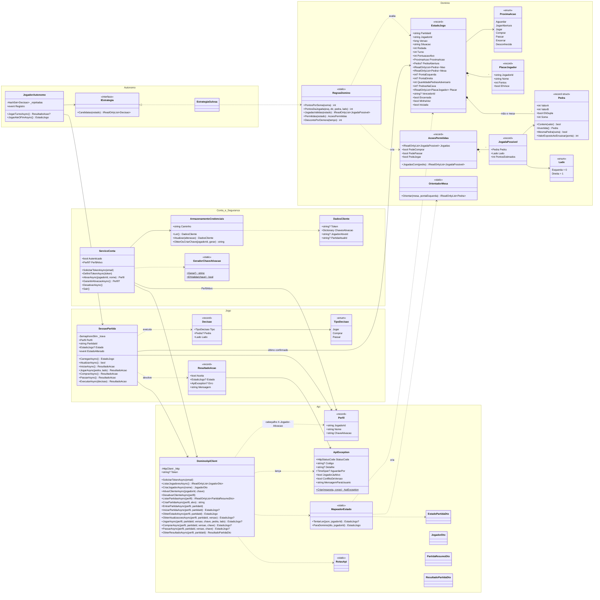
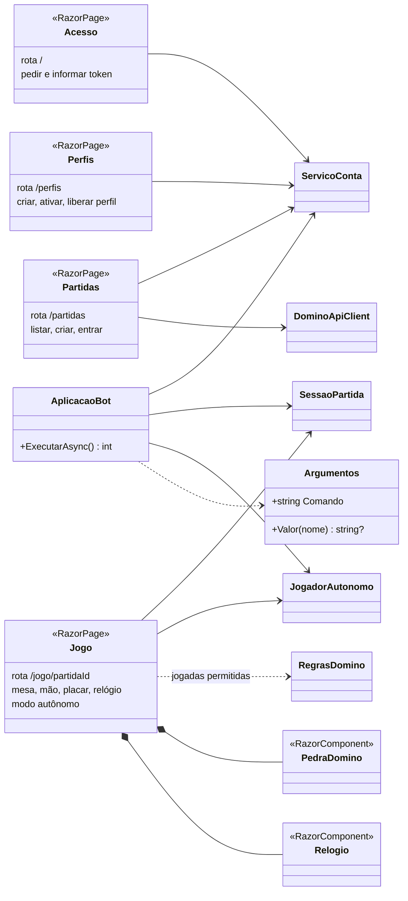
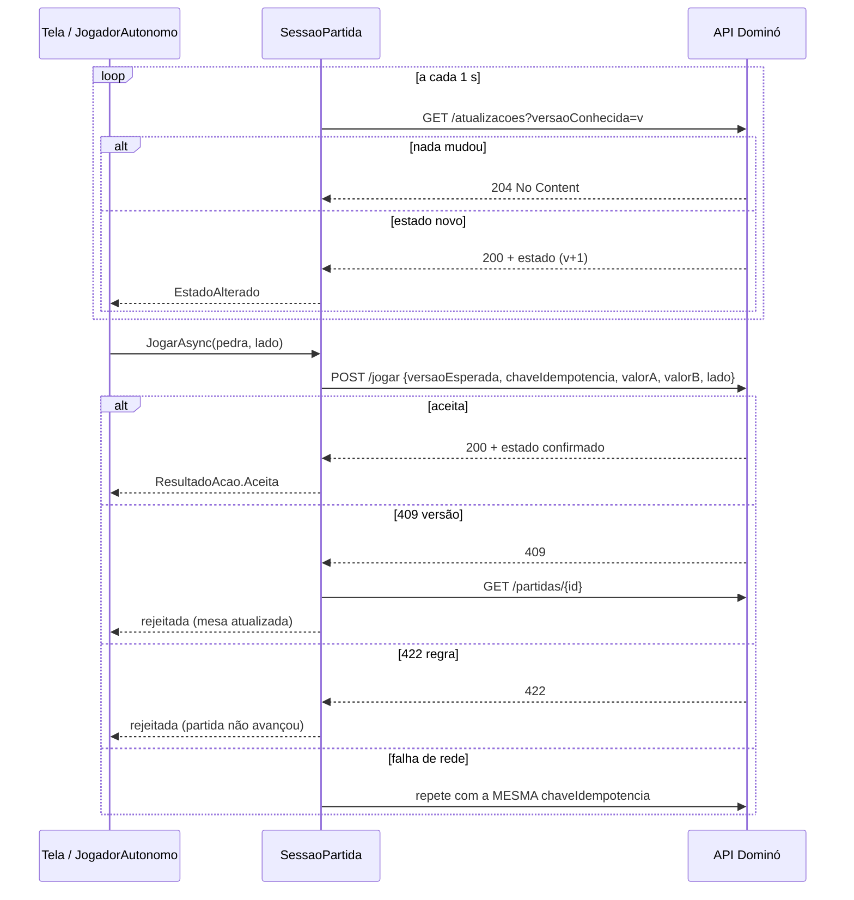

# Diagrama de classes

O diagrama usa [Mermaid](https://mermaid.js.org/) e é renderizado direto pelo GitHub.
O primeiro mostra o núcleo (`DominoQuina.Core`), que concentra as regras e a comunicação com a API.
O segundo mostra como a interface web e o bot de console usam o núcleo.

## Núcleo (`DominoQuina.Core`)

## Aplicações (`DominoQuina.Web` e `DominoQuina.Bot`)

## Sequência de um turno

